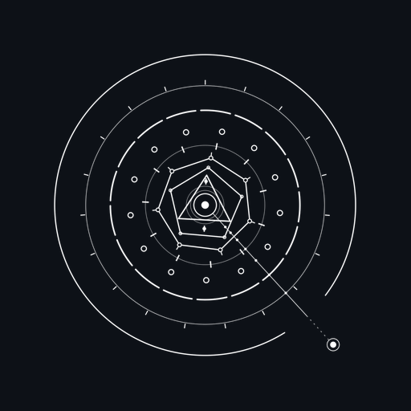

<p align="center">
  
</p>

<p align="center">
  <a href="https://github.com/Hatemshalaby15071979/Mannschaft/actions/workflows/ci.yml"></a>
  
</p>

<h1 align="center">Mannschaft</h1>

<p align="center"><strong>Deutsch hören, von A1 bis C2.</strong><br>
Lokal. Ruhig. Für einen Menschen.</p>

<p float="left">
  <strong>Mannschaft V6<br></strong><br>
  <span style="font-size:0.9em;color:#93aaa0">by Helix Solutions</span>
</p>

Mannschaft is a single-user, localhost, listening-first German learning app for
A1–C2. Twelve
hand-authored pilot lessons, six German TTS voices, rendered audio with measured
timelines, a YouTube clip per lesson, sentence cards, and an offline-capable PWA.

Everything runs on `127.0.0.1:8766`. Nothing phones home, nothing binds to a LAN
address, and no content is scraped at runtime. The current release is **V6**;
`v5/` is the internal tree name.

> **Publication status (verified 2026-11-22):** this is the published product
> repository. The founder's local umbrella working copy carries the planning
> plans, archives and a top-level README under `v5/`; the two are reconciled —
> same story, same canonical Helix mark, paths adjusted for each repository root.

---

## Honest status

| Fact | State |
|---|---|
| Lessons | **12** (2 per level, A1–C2), 55–141 segments each, authored by hand |
| Audio | Rendered and verified for all 12 (`content/audio/`, ~251 MB, not in git) |
| Corpus | 790 scored candidate clips from Easy German, **synthetic/uneven** (A1 has 3, B2 has 455) |
| Voices | Six VoiceStudio design profiles; VoiceStudio is **optional** for daily learning |
| Scale-out | M10 (72 lessons) and M11 (release) are **deferred** by the 2026-11-18 pilot decision |
| Dictionary | Local seed built from the lessons' own glossaries (542 entries) + outbound links only |
| Certification | None. This is not a certified course and does not claim to be |

The app is additive over the original eight-screen build: those screens, `/api/render`,
the service worker and every rendered file are untouched. V6 adds three screens
(Video, Karten, Wörterbuch) and four read-only routes.

---

## Install

### From the core zip (no audio, ~0.9 MB)

```bash
unzip mannschaft-core.zip -d Mannschaft
cd Mannschaft
python3 -m venv .venv && . .venv/bin/activate
pip install -e '.[dev]'
make check          # ruff + pytest
make serve          # http://127.0.0.1:8766
```

The core zip contains code, lessons, cards, the dictionary seed, the media
manifest, config and `clips.jsonl`. It does **not** contain rendered audio, so
lessons show their transcript and cards but no MP3 until you render.

### From the full zip (with rendered audio, ~213 MB)

```bash
unzip mannschaft-full.zip -d Mannschaft
cd Mannschaft
pip install -e '.[dev]'
make serve
```

The full zip adds `content/audio/` and the corpus working files. Everything
plays immediately; VoiceStudio is not needed.

### From source

```bash
pip install -e '.[dev]'
make check
make serve
```

---

## Run

```bash
make check                 # ruff + pytest (the gate)
make validate              # python -m v5 validate --all
make serve                 # foreground, 127.0.0.1:8766
make serve-bg              # detached, idempotent, logs to /tmp/opencode/
make stop-bg               # stop the detached server
make render ID=A1-01       # optional: synthesise + assemble (needs VoiceStudio)
make assemble ID=A1-01     # re-assemble from already-rendered segments
make corpus-suggest LEVEL=B1 SITUATION=work
```

Screens: `#/` (Heute), `#/library`, `#/lesson/<id>`, `#/play/<id>`,
`#/transcript/<id>`, `#/glossary/<id>`, `#/drill/<id>`, `#/progress`,
`#/clip/<id>`, `#/cards/<id>`, `#/dict?q=…`.

---

## Package

```bash
make dist-core             # dist/mannschaft-core.zip   (CI builds this; ≤20 MB)
make dist-full             # dist/mannschaft-full.zip   (local only)
make dist-check            # unzip into an empty dir, run help/validate/pytest/health
```

`dist-check` is the release gate: it proves the archive works outside this tree.

---

## Regenerate derived content

All derived JSON is generated, checked in, and never hand-edited:

```bash
python -m v5.media.select       # content/lesson_media.json
python -m v5.cards.build        # content/cards/<lesson>.json
python -m v5.dictionary.seed    # content/dictionary/seed.json
```

Each has `--check` to fail when the checked-in file is stale. Manual media
corrections go in `content/lesson_media.overrides.json`, which the selector
merges last.

---

## Architecture

```
src/v5/contract     Lesson Script v1 models + validator   (frozen)
src/v5/render       segment renderer, cache, ffmpeg assembler (frozen)
src/v5/adapters     longform + SRT (frozen)
src/v5/corpus       stages A–C, scoring, suggest (frozen)
src/v5/server       FastAPI app, catalogue, progress, jobs (frozen except app.py)
src/v5/client       vanilla ES modules, PWA, 11 screens
src/v5/media        V6 clip selector + manifest contract
src/v5/cards        V6 card generator + contract
src/v5/dictionary   V6 seed + local lookup + outbound links
src/v5/events       V6 card_graded / clip_opened event store
```

V6 deliberately keeps the frozen modules byte-identical. New schemas live next
to their generators, not in `contract/`, so the legacy hash snapshot stays
empty. See `tools/hash_legacy.py`.

---

## Brand

**Mannschaft** is the platform name. The mark is the founder company's helix
geometry engraving, supplied as `brand/helix_codex_inevitable_engraving.pdf`
and rendered to web assets by `tools/make_logo.py`:

```bash
make logo
```

- `src/v5/client/assets/logo-mark.png` — white ink on transparency; the light
  theme inverts it in CSS.
- `src/v5/client/assets/logo-badge.png` — dark square used by the READMEs.
- `src/v5/client/icons/` — PWA icons, Apple touch icon and favicon, regenerated
  from the same mark.

The mark sits in both persistent chromes (sidebar and topbar), so it is visible
on every route and every screen. It breathes slowly, and a conic sweep masked
by the engraving travels across the lines; `prefers-reduced-motion` disables
both. The asset is precached, so the brand survives offline.

---

## Content and provenance

- Lessons are **re-authored** from Easy German material, never transcribed
  verbatim into the product. Clips are embedded from `youtube-nocookie.com`
  with start/end; nothing is downloaded or re-hosted.
- Dictionary entries come only from the lessons' own glossaries. DWDS,
  Wiktionary, Cambridge and Collins are **links**, not copied content.
- VoiceStudio weights and Easy German material are not redistributed. The
  release zip contains code and authored lessons only.

---

## Layout

```
content/lessons/       12 authored lessons
content/audio/         rendered MP3s + timeline + SRT + per-line clips (not in git)
content/cards/         generated card decks
content/dictionary/    generated seed
content/corpus/        clips.jsonl (committed) + sqlite/cache (ignored)
config/                voices.toml, levels.toml, corpus.toml
tools/                 hash guard, packaging, dist check, serve scripts, logo + icons
tests/                 227 tests: contract, render, server, client, V6
```

See `STATUS.md` for the milestone log and the current next action.
