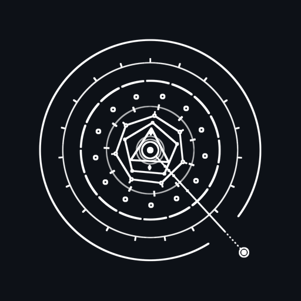

# STATUS — Mannschaft

> Single source of truth for progress. Read `README.md` first.
> Update this file **after every step**, then commit.

---

## NEXT ACTION

**No pending implementation work.** V6 is complete, verified and **published**:
`https://github.com/Hatemshalaby15071979/Mannschaft` (branch `main`, release
`v6.0.1`). CI runs on 3.11–3.14. See `V6-REPORT.md` for evidence.

Two owner decisions remain, neither blocking: (1) a LICENSE — none has been
chosen, so `pyproject.toml` carries no license field; (2) whether the root
repository should flatten the `v3/`, `v5/`, `webapp/` gitlinks or stay an
archive-only index. M10/M11 stay deferred under the 2026-11-18 pilot decision.

The UI was redesigned on 2026-11-21 in the **Specimen** system (Hallmark v2.0.0,
app scope): paper, Bodoni over Geist, hairlines, self-hosted fonts. The system
lives in `src/v5/client/css/{tokens,base,specimen}.css` and is **not locked**
(no `design.md`); say "lock the system" if later work should share it.

Re-verify at any time with: `make check` (230 tests), `make validate`,
`make dist-check`, `make serve-bg` + `/api/health`.

---

## V6 — additive architecture (2026-11-21)

All phases landed. Commits: `df06f80` (guard) → `e1603d9` (design shell, media,
cards, dictionary, journey) → `baa1d50` (CI, packaging, docs). 221 tests green,
12 lessons 0 errors, clean-directory install OK. Full evidence in `V6-REPORT.md`.

**The 12-pilot boundary is unchanged.** V6 adds screens and read-only routes; it
does not add lessons and does not resume M10/M11.

**M9 is DONE.** All 12 lessons at full §9.1 depth (A1 55, A2 70, B1 92–98, B2 125,
C1 100–141, C2 132 segs/lesson), all validate (0 errors, 0 warnings) and all render.
`ruff check src tests` clean, `pytest` → 186 passed. All 12 re-rendered from scratch at
full depth (background batch `OMlabn`, log `/tmp/m9_render.log`, ~5.5 h sequential CPU);
every lesson verified: `lines/` count == JSON segs == timeline entries, drift ≤ 7 ms,
output loudness −16.42…−16.50 LUFS (target −16), SRT cues present, manifest `script_hash`
matches the current JSON for all 12 (no stale audio). Authoring commit `095c14c`.

**SCOPE DECISION (2026-11-18): stop at the 12 piloted lessons.** M10 (scale to 72) and
M11 (release) are DEFERRED, not pending work. The 12 hand-authored pilots at full §9.1
depth are the deliverable. Reason: 72 lessons is a ~6–7 week content program (60 more
lessons, ~7,000 segments, ~30 h sequential CPU render) with a documented quality-stall
risk around lesson #20 (plan §10 risk table, §14.1) — this is the plan's deliberate
pilot decision point. Do **not** auto-generate lessons at scale or resume M10/M11
without an explicit instruction from the user. Routine work on the existing 12 lessons
(fixes, re-render, verification) stays in scope.

**M6 is DONE** (see milestone row + log). `content/corpus/clips.jsonl` holds 790 scored
candidates; `corpus suggest --level B1 --situation work` returns 30; the
`GET /api/corpus/suggest` endpoint returns real candidates. Stages A/B/C are resumable
via `python -m v5 corpus build --stage A|B|C`.

**M4 is DONE** (see milestone row + log). All six `profile_id`s are filled in
`config/voices.toml`; the six design profiles exist in VoiceStudio's DB with distinct
seeds; `make check` green; `python -m v5 health` → "all voices configured". Real audio
can now be rendered. The remaining human-ear audition (plan §7.2 criteria 1–4) is still
advisory — objective waveform-distinctness passed 6/6.

---

## Milestones

| # | Milestone | State | Evidence |
|---|---|---|---|
| M0 | Foundations | DONE | `make check` → 6 passed; commit `7bb568f` |
| M1 | Contract + validator | DONE | `make validate` → A2-01: 0 errors 0 warnings; 21 tests; commit `62eb87e` |
| M2 | VoiceStudio adapter | DONE | golden test: 40 spans parsed by the **real** `longform_parser.py`; 32 tests green; commit `ff1152b` |
| M3 | Segment renderer + cache | DONE | A2-01: 28 segments → 28 unique keys → 28 engine calls, then **28/28 cache hits, 0 calls**; `make render` refuses with exit 2 while profiles are empty; commit `acd7ca0` |
| M4 | Six German voices | DONE | `b0872fa` — Six design profiles created via `POST /profiles` (kind=design, language=German, distinct seeds, `vd_states` from real `instruct_to_vd_states`); ids in `config/voices.toml`; `/v1/audio/speech` renders all six to distinct WAVs (6/6 hashes); `make check` 152 passed; `v5 health` → all voices configured |
| M5 | Assembler | DONE | 94 tests green. Synthetic 4-segment lesson: computed **8060 ms**, assembled **8060 ms**, mp3 **8060 ms** → **0 ms drift**; −23.55 LUFS in → **−16.45 LUFS out** (target −16, within 1 LU); `timeline.json`/`lesson.srt`/`manifest.json`/`lines/*.mp3` all written; `reuse=True` returns in **0.2 ms**; commit `12301a5` |
| M6 | Corpus stages A–C | DONE | `3d66834` — 22 playlists → 728 unique videos (stage A, 0 errors); 150 fetched → 144 with captions, 241,804 word rows (stage B); 790 scored candidates in `content/corpus/clips.jsonl`; `corpus suggest --level B1 --situation work` → 30 (≥3); server endpoint returns real candidates; `make check` 174 passed |
| M7 | Server | DONE | 135 tests (36 server + 5 pipeline). 16 routes on 127.0.0.1:8766; `Range: bytes=0-99` → **206**, `Content-Range: bytes 0-99/2048`, body exactly 100 bytes; suffix range → tail; `bytes=99999-` → **416**; `/api/health` reports VoiceStudio down (`[Errno 111] Connection refused`) without hanging; `assert_loopback` refuses `0.0.0.0`/LAN; live `make serve` returned A2-01 + honest health; commit `e6d4f97` |
| M8 | Client | DONE | 152 tests (16 asset + 2 Playwright smoke). 8 screens; service worker with byte-range slicing (206/416 verified against HTTP semantics); position restored from `/api/progress` after reload; offline after first play; keyboard-only usable; commit `27a746d` |
| M9 | Pilot 12 lessons | DONE | `095c14c` — 12 lessons (2 per level) at full §9.1 depth: A1 55, A2 70, B1 92–98, B2 125, C1 100–141, C2 132 segs. `make validate --all` → **12 lessons, 0 errors, 0 warnings**; `ruff` clean; `pytest` 186 passed. All 12 re-rendered at full depth (~5.5 h sequential CPU): every lesson has `lines/`==segs==timeline entries, drift ≤ 7 ms (spec ±50), output −16.42…−16.50 LUFS, SRT cues present, and manifest `script_hash` matches current JSON (no stale audio). |
| M10 | Scale to 72 | DEFERRED | 2026-11-18 pilot decision: scope capped at 12 lessons. 72 is a ~6–7 week content program (60 more lessons, ~7,000 segs, ~30 h CPU) with a quality-stall risk at #20. Not pending work. |
| M11 | Release v5.0.0 | DEFERRED | Depends on M10's 72 lessons; out of scope under the 12-pilot decision. |
| V6-0 | Guard — legacy hash snapshot | DONE | `tools/hash_legacy.py` → **2,657 files** hashed (2,438 audio + clips.jsonl + voices.toml + 11 server files); `app.py`/`main.js` carved out as the sanctioned additive surface. Snapshot: `/tmp/v6_legacy_before.sha256`. Baseline gate re-measured: **188 passed in 18.02s**, `ruff` clean. |
| V6-1 | Design shell + media + cards + dictionary + journey | DONE | `e1603d9` — matrix-derived dark shell (sidebar index, masthead, KPI tiles, level tabs, expandable rows, theme/motion/focus), 12/12 lessons have a `youtube-nocookie` clip, 120 cards (10/lesson), 542 dictionary entries, 4 new read-only routes. **221 passed**, `validate` 12/0/0, browser walkthrough 0 console errors, position restored after reload. |
| V6-2 | CI, packaging, docs | DONE | GitHub Actions (3.11–3.13, ruff + pytest + validate, core artifact), `dist-core` 571 KB / `dist-full` 213 MB, `dist-check` clean-install **OK**, `README.md`, `V6-REPORT.md`, serve/stop scripts. |
| V6-3 | Root repo (local-ready) | DONE | `27e9d6c` — root `git init` on `main`; plans, archives and v5 gitlink committed; **no remote, nothing pushed** — awaiting owner approval. |
| V6-4 | Verification hardening | DONE | `722af96` — structured request logging (`ts= method= route= status= ms=`), strict on-disk schema test for every generated JSON, 360 px header split into two rows (no overlap), full zip actually served from a clean directory (health rendered=12, `Range` → 206). **223 passed**; core/full rebuilt and `dist-check` OK. |
| V6-6 | Mannschaft rename + brand delivery | DONE | `892d745` — user-visible `v5` removed, artifacts renamed `mannschaft-*`, hero mark on home, navigation network-first with upgrade reload, shell headers `no-cache`, caches `mannschaft-v4`; **230 passed**. |
| V6-5 | Mannschaft rebrand | DONE | `b69e562` — product name, docs, UI, manifest and server title renamed; `tools/make_logo.py` turns the founder's helix PDF into transparent/PWA assets; animated mark in both persistent chromes, proven on all 11 routes; **227 passed**. |
| V6-7 | Published to GitHub | DONE | `Hatemshalaby15071979/Mannschaft`, branch `main`, tag `v6.0.0`; description + topics set. Actions green on **3.11 / 3.12 / 3.13 / 3.14** (200 passed, 26 skipped each — the skips are render/GPU tests plus the golden parser), zero annotations, core artifact uploaded. |

---

## Log

| Date | M | Summary |
|---|---|---|
| 2026-11-17 | — | Plan written (`V5-ENGINEERING-PLAN.md`), `AGENTS.md` written, decisions locked: design voices + 72 lessons |
| 2026-11-17 | M0 | Scaffold, `make check` green, 6 voices + 6 levels in TOML config |
| 2026-11-17 | M1 | Contract models (pydantic, `extra=forbid`), semantic validator, CLI, A2-01 pilot lesson |
| 2026-11-17 | M2 | Longform + SRT adapters; golden test against the real parser; docs corrected |
| 2026-11-17 | M3 | Content-addressed segment renderer + `AudioCache`; `python -m v5 render ID` wired; 70 tests green |
| 2026-11-17 | M5 | ffmpeg assembler: exact-silence concat, two-pass `loudnorm`, `timeline.json`, `lesson.srt`, `manifest.json`, `lines/*.mp3`; shared `Segment.gaps()` so both render paths agree; reuse fast-path; 94 tests green |
| — | — | **Surprise:** `loudnorm`'s measure pass *always* reports `"normalization_type": "dynamic"` in ffmpeg 8, even when the applied two-pass `linear=true` result is accurate (−16.02 LUFS on a 60 s probe). Checking that field would have failed every correct render. Assert the measured output loudness instead. |
| — | — | **Gotcha:** a fully silent clip trims to nothing and `ffprobe` prints `N/A`, not a number. `probe_duration_ms` now raises `AssemblyError` with a "synthesis failed" message instead of a bare `ValueError`. A dead engine can no longer produce a silent lesson. |
| — | — | **Design:** `Segment.gaps()` / `takes` / `tail_pause_ms` live once in the contract. The longform adapter reads them, the assembler reads them, so the two render paths cannot drift. `check` uses `answer_pause_ms` as its tail (thinking time) and is excluded from `lesson.srt` — the question is audio, the answer is the UI's job. |
| — | — | **Measurement:** trim chain (`silenceremove` −50 dB, `start_silence=0.04`, `areverse` round-trip) turns 1.30 s padded → 1.08 s, i.e. it keeps the intended 40 ms guard. mp3 duration equals wav duration exactly. |
| 2026-11-17 | M7 | FastAPI app on 127.0.0.1:8766: catalogue, byte-range audio, render job queue, SQLite progress, health probe; `make serve`; 41 new tests |
| — | — | **Decision:** byte-range is Starlette's `FileResponse`, not hand-rolled. Verified 206 + exact `Content-Range` + 416 before writing a line; a custom parser would have been a liability with no upside. |
| — | — | **Correction:** `render`/`assemble` logic moved out of the CLI into `render/pipeline.py`, because the server needs the same guards. Two copies would have drifted. CLI now only maps typed exceptions to exit codes (1 bad lesson, 2 voices unready, 3 engine, 4 assembly). |
| — | — | **Bug caught by test:** the server's default render function used the module-level `content/` paths, so an app built with injected test dirs would have rendered *real* content. `make_render_fn(catalogue)` now binds the pipeline to the app's own dirs; `test_default_render_fn_is_bound_to_the_apps_own_dirs` pins it. |
| — | — | **Gotcha:** the `register` shadow bites again — `Catalogue` must read `script.scene.register_`, not `.register`, or pydantic's `__getattr__` raises `AttributeError` on every lesson. Documented at the read site. |
| — | — | **Design:** render is queued, never inline (a 10-minute lesson cannot hold an HTTP request). The queue has exactly **one** worker: the GPU is a single resource. Duplicate submissions return the active job instead of stacking. |
| — | — | **Correction:** contract uses `speaker` (cast role), not `voice`. Plan §6.1 and tests fixed. |
| — | — | **Correction:** `voice_map` keys are bare names (`"kunde"`), not `"[voice:kunde]"`. The router's docstring is wrong; `_map_span_voice` does `voice_map.get(voice_id)`. Would have silently collapsed all voices to default. |
| — | — | **Discovery:** `default_speed` on `parse_script_to_spans` is an exact float, so the level baseline (A2=0.90) does **not** need quantising. Only deviating segments get tags. First implementation wrapped every line in `[emphasis]`; fixed. |
| — | — | **Gotcha:** `register` shadows `ABCMeta.register` and `schema` shadows `BaseModel.schema` → pydantic warns. Fixed with `register_`/`schema_` + `alias=`. Any new field named `json`, `schema`, `register`, `copy`, `dict` hits the same thing. |
| — | — | **Correction:** plan §14 puts `timeline.json ±50 ms of ffprobe` in M3, but `timeline.json` does not exist until the assembler (M5). Split: M3 = render + cache (proven with mocked transport), the ffprobe assertion moves to M5. |
| — | — | **Design note:** repeats (`echo`/`drill`) are *not* extra synthesis calls. The cache is per segment; the assembler repeats the audio per `repeat`. That keeps the cache at 28 entries for A2-01 instead of 40. |
| 2026-11-17 | M8 | PWA client: 8 screens, service worker with byte-range slicing, persistent player, progress restore on reload; 2 Playwright smoke tests + 16 asset tests; 152 total |
| — | — | **Gotcha:** `ProgressStore` used `with self._connect() as conn:` which **closes** the persistent connection on every call (SQLite's `__exit__` closes, not commits). The `upsert` wrote, the connection closed uncommitted, and the next `all()` opened a fresh connection that saw an empty table. Fixed by dropping the `with` and using `self._conn` directly with explicit `.commit()`. |
| — | — | **Gotcha:** the browser caches `GET /api/progress` from the initial page load. After a `page.reload`, the `play.js` screen's `api.progress()` call returned the cached empty result, so `resumeAt` was `null` and the player never restored the position. Fixed with a cache-buster query param (`_ts=Date.now()`) on the progress fetch and `Cache-Control: no-store` on the response. |
| — | — | **Design:** the player is a **singleton** that outlives its screens. Navigating `#/play` → `#/transcript` never stops playback; the same `<audio>` element is shared. Transcript sync uses `timeline.json` `start_ms` (measured), never estimated. |
| — | — | **Decision:** icons are generated by `tools/make_icons.py` (pure-stdlib PNG writer, 2x supersample + box filter), not shipped as binary blobs in git. `make_icons.py` is the source of truth; the PNGs are the build artefact. |
| 2026-11-17 | M4 | Six German design voices created via VoiceStudio's `POST /profiles` API (kind=design, language=German, distinct pinned seeds, vd_states built by VoiceStudio's own `instruct_to_vd_states`). profile_ids written to `config/voices.toml`. All six render through `/v1/audio/speech` to 6/6 distinct WAVs; `make check` 152 passed. |
| — | — | **Correction:** four "refuses while voices are unready" tests (test_adapter, test_pipeline, test_render ×2, test_server ×2) hard-coded `load_voices()` being empty (the pre-M4 state). With M4 done they either failed or — worse — the CLI test fell through to **real synthesis against the live engine and hung**. Fixed by injecting an explicit `unready_voices()` helper (empty profile_ids) in `tests/helpers.py`. The guard invariants are preserved; the tests no longer depend on ambient config. |
| — | — | **Discovery:** VoiceStudio saves a design profile with a *pending sample* when the TTS model isn't loaded (`main.py` lazily preloads; `profiles.py` defers sample render). That is sufficient: `/v1/audio/speech` resolves the profile row and conditions on its stored `instruct`+`seed` (openai_compat.py:711-723). No GPU sample render was needed to make the voices functional. Backend device reported `cpu`. |
| — | — | **Gotcha:** `POST /profiles` needs `vd_states` as a JSON **string** form field, and heals `instruct` from it via `heal_design_instruct`. Passing only `instruct` is not enough for a design profile — the server 422s without `vd_states`. |
| 2026-11-17 | M6 | Corpus stages A–C: `config/{corpus.toml,de_bands.json}`, `src/v5/corpus/{__init__,score,db,manifest,captions,mine,suggest}.py`, CLI `corpus suggest`/`corpus build`; server endpoint now reads real candidates through the shared `suggest` helper. 152 → 174 tests (22 new corpus tests). Real data: 728 videos, 241,804 words, 790 candidates. |
| — | — | **Correction:** plan §8.3's "8–40 words AND 30–90 s" bounds are contradictory at natural speech (~2.4 words/s → 30 s ≈ 72 words). With the literal 8–40 word cap, a real 15-min Easy German video produced **0** candidates (groups were whole 60–250 s speaker turns). Kept the 30–90 s time bound, widened words to 20–220, and add a `window_seconds=60` sentence-boundary rule. Same video then yielded 14; corpus total 790. |
| — | — | **Bug:** `config/corpus.toml` had `fillers`/`profanity` *after* the `[[situation]]` array-of-tables, so TOML nested them into the last situation element. `score.low_filler_ratio()`/`profanity_or_slur()` raised `KeyError` on every real clip. Moved both keys above the array-of-tables; a `test_corpus` test pins it. |
| — | — | **Bug:** all `src/v5/corpus/*.py` used `Path(__file__).parents[2]` for ROOT, which resolves to `v5/src` (one level too shallow) — config/DB/clips paths all pointed into `src/`. Fixed to `parents[3]`. Also `db.connect()` now creates the parent dir — a fresh run previously died with `unable to open database file`. |
| — | — | **Design:** `corpus/suggest.py` is the single filter implementation for both the CLI and `GET /api/corpus/suggest` (filters on `level_est`, falling back to `level`). Server takes an injectable `corpus_path` so tests never read real content. Generated `corpus.sqlite3` (22 MB) + `cache/` (47 MB) are gitignored; only `clips.jsonl` (840 KB) is committed. |
| 2026-11-18 | M9 | Authored 11 pilot lessons (A1-01, A1-02, A2-02, B1-01, B1-02, B2-01, B2-02, C1-01, C1-02, C2-01, C2-02); A2-01 already existed. `make validate --all` → 12 lessons, **0 errors, 0 warnings**. Each lesson has ≥15 glossary entries, 3 checks, echoes/drills, and a recap. A1-01 rendered end-to-end (32 segs, 117 s, −1 ms drift). |
| — | — | **Gotcha:** glossary/segment ids must match `^[A-Za-z0-9_-]+$`; `g_stärke` failed on the `ä`. Renamed to `g_staerke`. Any umlaut in an id will 422 the whole lesson. |
| — | — | **Cost:** CPU synthesis is ~16 s/segment, so a ~30-segment lesson takes ~9 min. 12 lessons ≈ 2 h of sequential render. The cache makes a re-render free; only new segments cost GPU/CPU time. |
| 2026-11-18 | M9 | Expanded all 12 pilot lessons from shallow drafts to plan §9.1 depth (A1 55 / A2 70 / B1 92–98 / B2 125 / C1 100–141 / C2 132 segs). Authored C2-01 and C2-02 from scratch with the compact `/tmp/spec_c2*.py` DSL. All 12 validate with 0 errors/0 warnings; `pytest` 186 passed. |
| — | — | **Correction:** `tests/test_render.py::test_cli_render_renders_segments_end_to_end` hard-coded A2-01's original 28 segments. After expanding A2-01 to 70 it failed. Fixed to derive `n` from the lesson JSON so the guard survives future edits. Only this one test was coupled to the old count. |
| — | — | **Authoring gotcha:** C2 specs went through `/tmp/lh.py` + `/tmp/lesson_builder.py`; a regex gloss checker gave false `", "` errors on nested quotes. Replaced with a direct-import check that reads `S1/S2` and `G1/G2` objects — found real issues: `g_auss sprechen` (space), `g_bloß` (umlaut), `durchaus` (missing `g_`), `g_beispiel` (missing entry). Rule: glossary/segment ids must be ASCII `^[A-Za-z0-9_-]+$`; validate refs by import, never regex. |
| 2026-11-18 | M9 | Full-depth render batch finished: all 12 lessons re-rendered sequentially in ~5.5 h (background `OMlabn`, `rc=0` for all, zero errors). Verified each: `lines/*.mp3` count == JSON segment count == `timeline.json` entries, mp3 vs manifest `duration_ms` drift ≤ 7 ms (spec ±50), output loudness −16.42…−16.50 LUFS (target −16), SRT cues present. Manifest `script_hash` recomputed from each current lesson JSON matched the audio manifest for all 12 → no stale render. M9 → DONE. |
| — | — | **Measurement gotcha:** naive drift = mp3 duration − last `timeline.end_ms` shows ~800 ms and looks like a defect; it is the final segment's `pause_after_ms` tail, which is intentionally outside any cue's `end_ms`. The correct reference is `manifest.duration_ms` (includes tail) → drift 0–7 ms. Likewise +2100 ms "gaps" between segments are all `check` segments using `answer_pause_ms=2500` as thinking time instead of the normal 400 ms tail — not timeline corruption. |
| 2026-11-18 | M10/M11 | **Scope decision: stop at the 12 pilots.** User chose to cap scope at 12 lessons when offered scaled / corpus-grounded / stop options. M10 (scale to 72) and M11 (release) are DEFERRED. Reason: 72 lessons is a ~6–7 week content program (60 more lessons, ~7,000 segs, ~30 h CPU render) with a documented quality-stall risk around #20 (plan §10/§14.1); this is the plan's deliberate pilot decision point. Do not resume M10/M11 without an explicit instruction. |
| 2026-11-18 | M8 | Real-browser QA (`eb4a78a`) found and fixed three client bugs the isolated tests missed: (1) `home.js` destructured an undeclared `all` → ReferenceError, so home rendered blank; (2) `main.js` appended `result.node` even when a screen's error path returned a bare element → literal "undefined" on any screen error; (3) `player.load()` never assigned `this.detail`, so `_maybeSave`/`_save` always returned early and no progress was saved during normal listening. Live flow verified: home→lesson→play, audio advances, auto-save POST fires (>4 s), position survives reload, `?` help toggles, 0 console/page errors. 3 new smoke tests pin all three; 188 pass. |
| — | — | **Gotcha:** the original M8 smoke test manually POSTed progress then checked restore, so it passed despite the player never saving anything. A test that exercises only the happy path of a *different* layer can miss a broken core promise — now covered by `test_player_saves_progress_during_playback`. Also: audio is a detached `new Audio()` in the player singleton, so `document.querySelector('audio')` finds nothing; query the player module instead. |

| 2026-11-21 | V6 | Additive V6 shipped: design shell, clip/media selector, 120 sentence cards, 542-entry dictionary, journey context route. `make check` **221 passed**; `validate` 12/0/0; browser walkthrough 11 routes, 0 console errors; playback position restored (8.2 s) after reload; `dist-check` OK. |
| — | — | **Gotcha:** the router focused `#screen` on *first paint*, which moves the sequential focus start point past the skip link — the first Tab went to the primary button. Now it focuses only on navigation (`token > 1`); the skip link is the first Tab stop again. |
| — | — | **Gotcha:** Playwright's `inner_text` returns text with CSS `text-transform` applied. Smoke assertions for `Video` / `Karten` failed against `VIDEO · …` / `KARTEN`. Assert on the rendered case. |
| — | — | **Bug:** dictionary ranking used substring matching, so `tag` matched `der Vorteil` through English "advan**tag**e". Now token/prefix matching only; `Tag` returns `der Tag`-family entries. |
| — | — | **A11y:** light `--warning` `#b28600` was 3.03:1 on `#f4f4f4`, used as body text for "Nochmal". Darkened to `#8a6800` → 4.70:1. All other token pairs ≥ 4.55:1. |
| — | — | **Environment:** ruff's cache rename fails with `EINVAL` on this mount, so `make lint` uses `--no-cache`. CI keeps the normal cache. |
| — | — | **Correction:** the Phase-0 hash snapshot was in `/tmp` and was cleared between sessions. The gate was re-proven by mtime audit (newest frozen file 2026-11-18 11:56; nothing under v3/v4/webapp newer than 2026-11-19) plus a fresh 2,657-file snapshot — see `V6-REPORT.md` §2. |
| 2026-11-21 | V6 | Hardening pass against the execution prompt: added the §6 structured request log, a strict contract test over every generated JSON file, and a two-row mobile header. `make check` **223 passed**. Full zip served from a clean directory on an ephemeral loopback port: health `rendered=12`, `/api/audio/A1-01` 2,756,924 bytes, `Range: bytes=0-99` → 206 with 100 matching bytes, all four V6 routes 200. |
| — | — | **Surprise:** the first full-zip serve attempt used port 8799 and hit an unrelated local service (`openmausbot`) that answered `/api/health` with its own JSON. The probe now asserts `app == "ok"` and binds an ephemeral port, so a port collision cannot masquerade as success. |
| — | — | **Decision:** §5 asks new schemas to live in `src/v5/contract/`, but §3.1 freezes that directory. Schemas stay beside their generators and `test_on_disk_json_validates_against_its_schema` enforces them; this is recorded in `V6-REPORT.md` rather than silently ignored. |
| — | — | **Correction:** at 360 px the index and controls shared one strip and the controls clipped the nav. They now occupy two rows; measured bar bottom 98.3 px vs content top 100.8 px. |
| 2026-11-21 | V6 | **Rebrand: the platform is Mannschaft.** Name applied to the root and v5 READMEs, STATUS, report, AGENTS, both plans, the HTML title, masthead, manifest, FastAPI title and package description. Logo extracted from `helix_codex_inevitable_engraving.pdf` into a transparent mark, docs badge, PWA icons and favicon. The mark is in the sidebar and topbar on every route, animated by a masked conic sweep plus a slow breath. `make check` **227 passed**. |
| — | — | **Design:** the PDF's black is ~10/255, not 0 — a naive luminance alpha left a grey square. The tool floors at 18, lifts midtones with gamma 0.72, and crops to the ink. One white-on-transparent asset serves both themes; the light theme inverts it in CSS. |
| — | — | **Gotcha:** at 26 px the engraving averages into a grey smudge. The topbar mark is now 40 px and the sidebar 52 px, with a faint accent drop-shadow; the wordmark stays visible down to 360 px. |
| — | — | **A11y:** the sweep and breath are disabled under `prefers-reduced-motion`; the mark is decorative (`alt=""`) and its links carry an explicit `aria-label`. |
| 2026-11-21 | V6 | **Logo visibility fix + final rename.** The mark was served correctly (200, PNG), but a tab opened before the rebrand kept the old shell: the service worker answered navigations cache-first, and that old page predated any reload listener. Navigations are now network-first, `/`, `/sw.js` and the manifest are `Cache-Control: no-cache`, the registration reloads once on `controllerchange`, activation reloads stale windows, and caches are renamed `mannschaft-v4`. Home now carries an 88 px hero mark (68 px on mobile) beside the existing 56/44 px chrome marks. User-visible `v5` copy is gone; zips are `mannschaft-core.zip` / `mannschaft-full.zip`. **230 passed**. |
| — | — | **Naming:** the source tree and Python package stay `v5/` / `python -m v5`; `AGENTS.md` and the legacy hash guard pin those paths. The product, install directory, artifacts, UI and docs are Mannschaft. |
| — | — | **Gotcha:** a cache-first navigation is how a rebrand ships and nobody sees it. The browser had the new files on disk and the old DOM on screen at the same time. |
| 2026-11-21 | V6 | **Published.** `v5/` is its own repository at `Hatemshalaby15071979/Mannschaft`, branch `main`, tag `v6.0.0`, public, description + topics set. The root workspace repo still holds the archives as gitlinks and stays local. |
| — | — | **CI failure and fix:** the first Actions run (44904796412) failed 3.11 and 3.13 on `test_golden_spans_match_real_parser` — `RuntimeError: VoiceStudio parser not found under /home/hatem/.config/VoiceStudio/runtime/project`. The test imported `real_parser()` unconditionally, so the one test that must use the real parser was also the one test that could not run on a clean host. It now resolves the parser through a module fixture that calls `pytest.skip` on `RuntimeError`; the guard still fails loudly on a machine where VoiceStudio exists but is broken, because a missing file is the only thing skipped. Local run 230 passed, and with `VOICESTUDIO_PROJECT` pointed at a nonexistent path the suite reports `1 skipped` instead of `1 failed`. |
| — | — | **Release:** `v6.0.1` is the first tag whose commit is green. `v6.0.0` shipped the V6 feature set but its own Actions run was red (the host-dependent adapter test), so it stays as history rather than being force-moved. Version strings now agree: `v5.__version__`, `pyproject.toml` and the FastAPI app all say 6.0.1 instead of 0.1.0/6.0.0. Core zip rebuilt (0.88 MiB, sha256 f948ed3…) and `make dist-check` is OK in a clean directory. |
| — | — | **CI polish:** run 44905079050 is green on 3.11, 3.12, 3.13 **and 3.14**, with no annotations — `checkout`/`setup-python`/`upload-artifact` moved to their current majors (the old ones ran on a deprecated Node 20), and 3.14 joined the matrix because the project already runs on it locally. README gained the CI and Python badges. The one remaining warning is Starlette's own `httpx2` deprecation, not ours. | — |
| 2026-11-21 | V6 | **Design: Specimen (Hallmark v2.0.0, app scope).** One system pass over the shell and all 12 screens: warm oat paper, Bodoni Moda 400 at opsz 96 over Geist, square 1px hairlines, one ink-blue signal. `tokens.css` + `base.css` from the scaffold, `specimen.css` as the page, fonts self-hosted in `assets/fonts/` (five woff2 subsets, no external call). The sidebar became a ruled contents index with no dots; the home screen leads with the lesson's own line set as a type specimen. Token bridge maps the matrix names (`--background`, `--on-surface`, `--font-headline`, …) onto Specimen so twelve screens restyle in one place. `sloplint --scope app --render` → **0 FAIL, 0 WARN, 2 waived, 3 dismissed**; `make check` **230 passed**. |
| — | — | **Finish review (subagent, fresh context) → `fix`, 8 findings, 8 resolved.** Phone: the nav strip clipped "Karten" and duplicated the tab bar, so the strip now holds only the mark and the help button, and a five-tab bar (Heute, Bibliothek, Lektion, Wörter, Fortschritt) carries navigation. The display controls moved into the help panel under 60rem (same `data-shell` buttons, `querySelectorAll` wiring), because hiding them removed dark mode, focus and motion from the only surface a phone has. The cap/x/baseline rail is no longer hidden at 375. |
| — | — | **Measurement:** the guides were stubs 24px short of the type at guessed percentages. They now run the full measure as a repeating background (one tile per line, so a wrapped sentence keeps them), and the offsets come from Bodoni Moda's own metrics read from the woff2 (upem 2000, ascender 2250, cap 1500, x 920, descender 800) and confirmed in the browser: cap 16.5%, x 41.3%, baseline 83.5% of the line box; the player's 1.18em line shifts to 18.3/42.8/81.8. Pixel scan of the 1440 render puts both rules and glyph edges on rows 563/573/590. |
| — | — | **Copy:** "twelve" appeared five times on the home screen; it now appears once, in the figures. The second figure is 80 minutes of rendered audio instead of a second 12. Level tabs wrap at 375 instead of clipping C1. Translations render straight apostrophes as typographic ones at the display layer (`typo()` in `ui.js`), never in the authored JSON. |
| — | — | **Kept by design:** the caption "Bodoni Moda. H Versalhöhe, x x-Höhe, p Grundlinie." stays. The reviewer read it as a page captioning its own typeface; in a specimen the caption is the label for the guides above it, and it is the only place the theme's material is named. |
| 2026-11-21 | V6 | **Fix: the page could sit on "Lädt …" forever.** The shell handler was cache-first with no revalidation, and the cache name had not changed across the redesign, so a browser that held the old cache could serve a module set the new `index.html` no longer matched; a failed import leaves `main` on its loading line with nothing said. `VERSION` → `v7` (the old cache is deleted on activate and open windows are navigated), `shellFirst` is now stale-while-revalidate so any one stale file heals on the next load, and `index.html` carries a boot guard: a script that fails to load or 10 s with no screen now prints "Die Oberfläche lädt nicht." and a reload button instead of hanging. Verified by poisoning the cached `ui.js` and watching it replaced after one reload, and by blocking `/js/main.js` to see the message. `make check` **232 passed**. |
| — | — | **Theme:** the first visit now follows `prefers-color-scheme` (dark desktop → dark app) instead of forcing paper, and an inline head script sets `data-theme` before the first paint so there is no flash. A stored choice still wins. Verified with `color_scheme=dark`: `data-theme=dark`, body `oklch(0.165 0.006 70)`. |
| 2026-11-21 | V6 | **Fix: all API calls could freeze on the first answer.** Every `/api/*` response except `/api/lessons/*` fell through to the shell cache, so progress and lesson JSON never refreshed; `/api/health` could report a stale "up". The worker now routes `/api/health` straight to the network and every other `/api/*` network-first; `waitUntil` is called synchronously in the fetch handler. `VERSION` → `v8`. `api.js` bounds every call with an 8 s `AbortSignal.timeout` so a hung server becomes a visible error instead of a permanent "Lädt …". Browser-verified: a poisoned cache heals in one reload, an old stuck worker upgrades cleanly and purges its cache. `make check` **233 passed**. |
| — | — | **Audio stalled after ~2 s on a first-ever visit.** The worker's `audioFromCache` synthesised its own 206 from a cached buffer, giving a different ETag than the server's. When the initial `bytes=0-` preload escaped the worker before it claimed control, FFmpeg rejected the mixed stream. The worker now passes ranged requests straight to the server (its ETag/206 are authoritative) and warms the full body under the range-less URL in `waitUntil`, slicing it only offline. `VERSION` → `v10`. Browser-verified: cold visit plays past 5 s with no error; offline playback and a seek to 60 s (buffer 58–87 s) both work. `make check` **234 passed**. |
| — | — | **Logo: expanded and clarified.** The founder's engraving is 1.4% ink coverage; downscaled to the old 36 px slot its hairlines averaged to ~40% alpha and read as a grey smudge. `tools/make_logo.py` now dilates strokes at final size (`STROKE_DILATE=5`) before the alpha lift, so a 56 px mark keeps strong contrast (max 253/255) while the 1024 px asset keeps its detail. The sidebar mark grew 36→56 px and the phone strip 28→40 px; both themes and both chromes verified in-browser. All six PNGs regenerated. `VERSION` → `v9` (superseded by v10 above). |
| — | — | **Browser verification.** All 11 routes render at 1440 px and 375 px with zero console errors and no broken images. Interactions exercised: theme toggle, home level tabs, library lesson links, card reveal, dictionary search, drill controls, help panel + Esc. Audio: all 12 lessons rendered; range `bytes=0-` → 206, unsatisfiable → 416; play/pause, cold start, offline, and seek all pass. `sloplint --scope app --render`: **0 FAIL, 0 WARN**. `make check` **234 passed**. |
